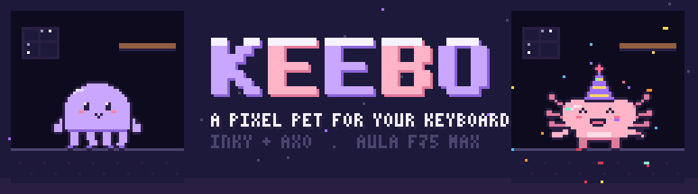
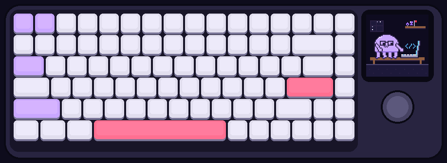
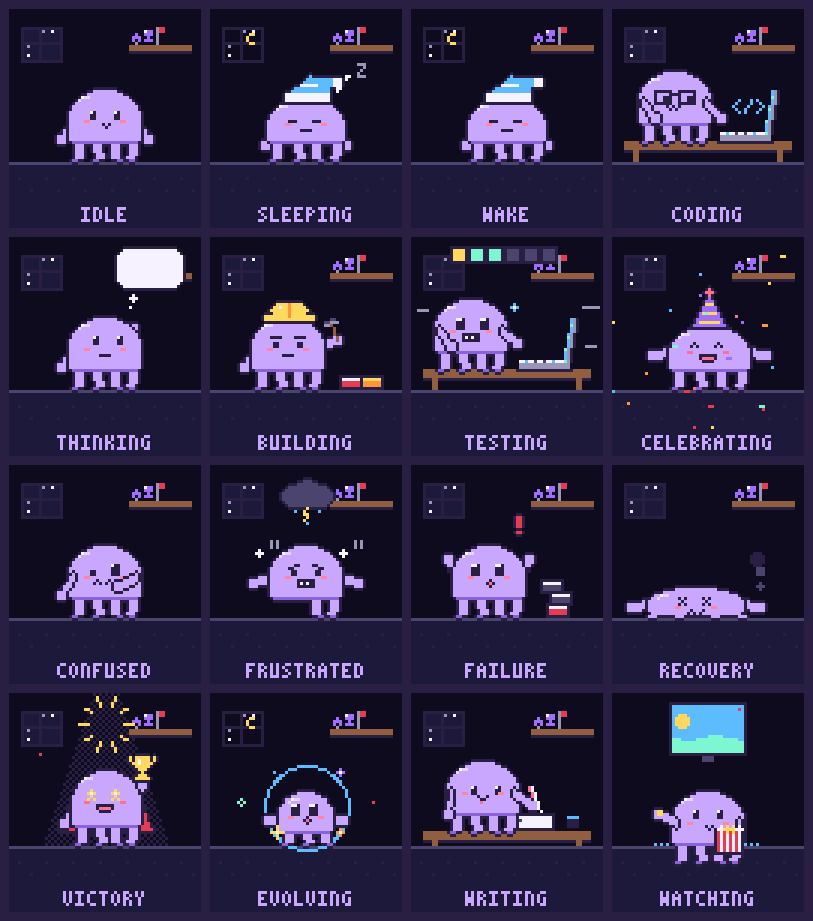
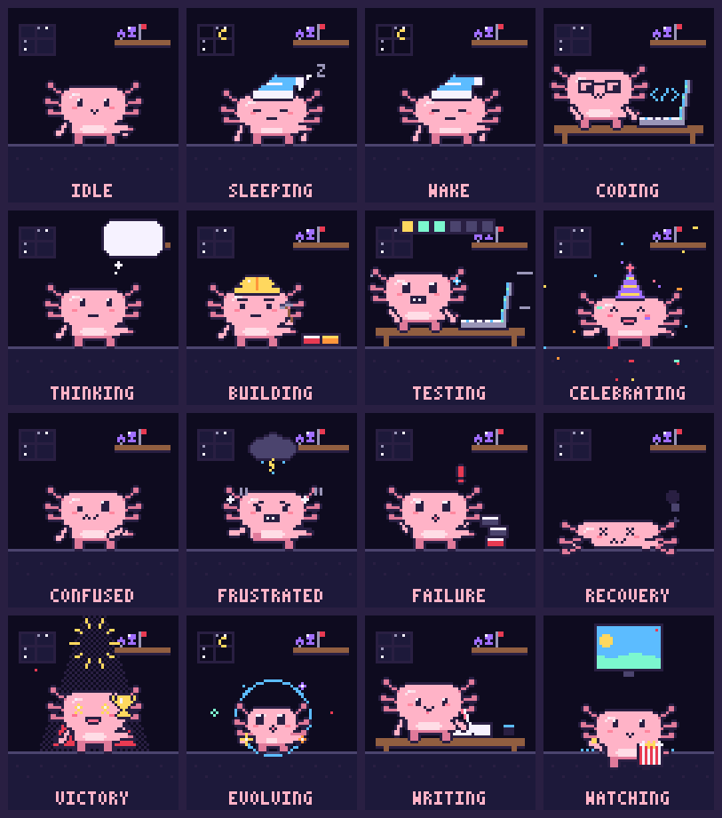
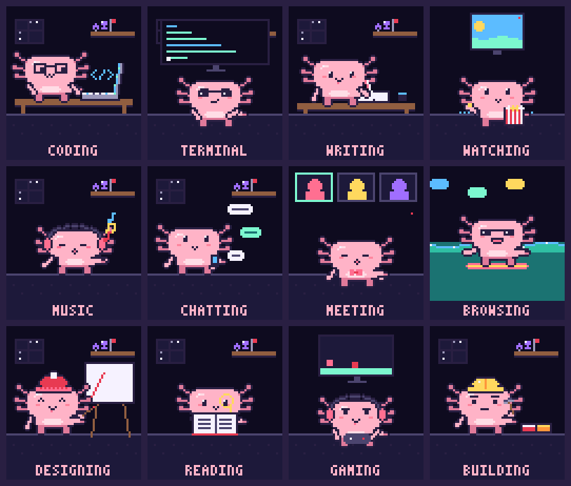
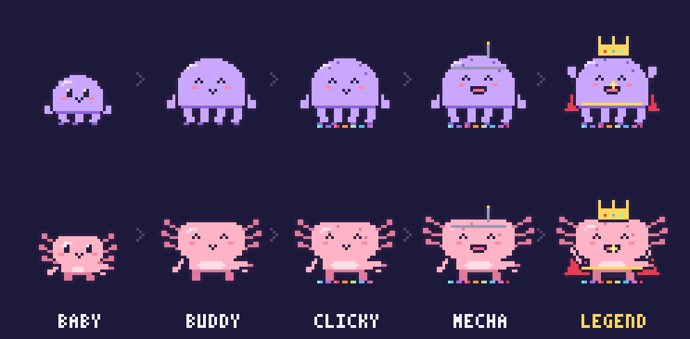
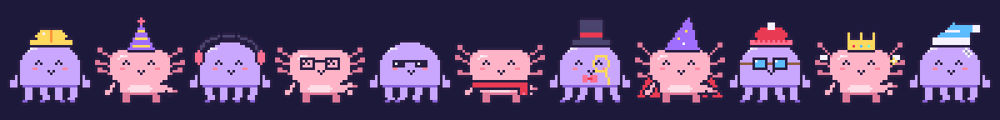

<div align="center">



**Tiny pixel-art companions for the 128×128 screen on your AULA F75 Max**<br>
They code when you code, panic when your tests run, throw a party when they pass<br>
and faceplant (then dust themselves off) when the build breaks.

[](#install)
[](#install)
[](docs/HARDWARE.md)
[](LICENSE)



</div>

---

## Meet Inky and Axo

Keebo comes in two skins, and you can swap between them at any time with `keebo skin`:

- **Inky**, a small lilac octopus. All tentacles, all heart. Types with four arms at once.
- **Axo**, a pink axolotl with frilly gills that wiggle when it's happy (which is most of the time).

Both are drawn on a 64×64 grid and shown at exactly 2× on the keyboard's
128×128 screen, so every pixel stays crisp. Neither is a pile of
hand-pasted frames. Each is a **parametric rig**: squash and stretch,
eyes, mouth, arms, tentacles or legs, gills, evolution form and
accessories are all pose parameters. So every animation moves smoothly,
and every one works for both creatures in every outfit they unlock.

<div align="center">
 
</div>

## They react to your work

| When... | Keebo... | Clip |
|---|---|---|
| you open a project | blinks awake, stretches, hops | `wake` |
| a coding agent starts a task | puts on a hard hat and stacks bricks | `building` |
| tests are running | types frantically, sweating, with speed lines | `testing` |
| tests pass | party hat, jumps and confetti | `celebrating` |
| tests fail | tilts its head, then stomps under a storm cloud | `confused` → `frustrated` |
| the build fails | collapses into a pancake while the build catches fire... | `failure` |
| ...and then | peels itself off the floor, slaps on a bandage, thumbs up | `recovery` |
| a task completes | raises a trophy in the spotlight | `victory` |
| you level up | glows, flashes and evolves into its next form | `evolving` |
| you go quiet for a while | puts on a nightcap and drifts off, *zzz* | `sleeping` |
| nothing in particular | breathes, blinks and glances around | `idle` |

## They know what you're doing

Keebo watches the frontmost app and the active browser tab, locally, using
only macOS's built-in AppleScript, and acts out a matching mini-scene.

<div align="center">

</div>

| You're in... | Scene |
|---|---|
| VS Code, Cursor, Xcode, JetBrains, Zed, GitHub, Devin, Claude... | `coding`: tapping away on a mini MacBook |
| Terminal, iTerm2, Warp, Ghostty... | `terminal`: shades on, green text scrolling |
| Outlook, Mail, Google Docs, Word, Notion... | `writing`: scribbling a letter with a quill |
| YouTube, Netflix, Twitch... | `watching`: munching popcorn in front of the TV |
| Spotify, Apple Music... | `music`: headphones on, bopping |
| Slack, Discord, Messages... | `chatting`: speech bubbles flying |
| Zoom, Meet, Teams... | `meeting`: on camera in a bow tie |
| Figma, Photoshop, Aseprite... | `designing`: painting at an easel |
| Preview, Books, arXiv, PDFs... | `reading`: nose in a big book |
| Steam, chess.com... | `gaming`: mashing a gamepad |
| any other browser tab | `browsing`: surfing the web, literally |

You can add more apps and scenes with one line of JSON or with a plugin
file ([see Extending](#extending)).

## They grow with you

<div align="center">

</div>

- **XP from finished work**: commits, green test runs, finished builds, completed agent tasks.
- **Five forms**: Baby → Buddy (lv 3) → Clicky (lv 8, spots and RGB underglow) → Mecha (lv 15, visor and antenna) → Legend (lv 25, crown).
- **Seventeen accessories** to unlock, from levels and from small achievements:

<div align="center">

</div>

- **Your projects become their history.** Each project you work on puts a
  trophy on the shelf behind them: a cup, a star once you've shipped 10
  tasks, or a battle flag for the hard-fought ones.
- **They're kind.** XP never goes down. A failure followed by a fix earns a
  *comeback* bonus (and the bandage). Taking a long break makes Keebo
  *well rested*: 1.5× XP for an hour. Breaks are never punished.

---

## Install

You need macOS (Intel or Apple silicon), Python 3.9 or newer, and an AULA
F75 Max **plugged in with a USB-C cable**. The screen only works over a
wired connection: Bluetooth and the 2.4 GHz dongle can't carry pixels.

```sh
git clone https://github.com/rayhankhilji/keebo && cd keebo
python3 -m venv .venv && source .venv/bin/activate
pip install -e ".[hid]"
```

Quit AULA's own app if it's running. Then:

```sh
keebo skin axo                 # or inky (the default)
keebo device list              # finds the keyboard (0c45:800a)
keebo device push celebrating  # one-off: put a clip on the screen
keebo run --display aula       # the live companion
```

`keebo run` also serves a live, pixel-perfect preview at
**http://127.0.0.1:7428**, so you can try Keebo before plugging anything
in. Run with no display flag, it only writes `~/.keebo/now.gif`.

> **Permissions.** The first time Keebo checks which app is in front, macOS
> asks whether your terminal may control *System Events* (and your browser,
> to read the tab URL). Say yes, or manage it later in System Settings →
> Privacy & Security → Automation. Keebo never reads keystrokes, and
> nothing leaves your machine.

**Start at login:** copy [`examples/launchd.plist`](examples/launchd.plist)
into `~/Library/LaunchAgents/` and fix the path to `keebo`.

## Hook it up to your work

Keebo listens on `127.0.0.1:7428`. Anything that can run a shell command or
make an HTTP request can poke it.

```sh
# wrap any command: Keebo guesses tests / build / agent from the command
keebo wrap -- pytest -q
keebo wrap -- npm run build
keebo wrap --kind agent -- claude -p "fix the flaky test"

# or send events directly
keebo emit project_start
keebo emit task_complete --project keebo
curl -s localhost:7428/event -d '{"kind":"tests_pass","project":"keebo"}'
```

| Integration | Setup |
|---|---|
| **git**: a little cheer on every commit | `keebo hooks git` (inside a repo) |
| **zsh**: wake on `cd` into a project, plus `kt`/`kb`/`ka` aliases | `keebo hooks zsh >> ~/.zshrc` |
| **Claude Code**: build while the agent works, victory when it stops | `keebo hooks claude`, then merge the output into `~/.claude/settings.json` |
| **Anything else** | `POST /event {"kind": ..., "project": ...}` |

Event kinds: `project_start`, `agent_start`, `agent_done`, `tests_start`,
`tests_pass`, `tests_fail`, `build_start`, `build_pass`, `build_fail`,
`task_complete`, `commit`, `thinking`, `confused`.

## Command line

```text
keebo run       [--display aula|terminal|file]... [--hud] [--sleep-after MIN]
keebo skin      [inky|axo]                 show or switch creature
keebo list                                 every animation and scene
keebo preview   coding victory [--skin axo]  play in your terminal (truecolor)
keebo render    building -o out            GIF + sprite sheet for one or more clips
keebo export    -o assets                  GIFs + sprite sheets for everything, both skins
keebo status                               level, XP, unlocks, project history
keebo equip     tophat                     wear something you've unlocked
keebo context                              what Keebo thinks you're doing right now
keebo device    list | push <clip|file.gif> [--dry-run]
keebo emit      <kind> [--project NAME]
keebo wrap      [--kind test|build|agent|task] -- <command>
keebo hooks     git | zsh | claude
```

## Sprite sheets and GIFs

Every clip for both skins is pre-rendered in [`assets/gifs/inky`](assets/gifs/inky)
and [`assets/gifs/axo`](assets/gifs/axo) (128×128, also ready for AULA's own
software), with matching sprite sheets in [`assets/sheets/`](assets/sheets)
(8 frames per row). Regenerate them with `keebo export`. The README
art comes from `python scripts/brand.py`.

## Extending

Keebo is built to grow. All of these take a few lines each, and
[docs/ARCHITECTURE.md](docs/ARCHITECTURE.md) walks through every one:

- **A new animation or scene**: decorate a function with `@animation("name")`
  and drop the file into `~/.keebo/plugins/`. No fork needed. See
  [`examples/plugin_rubber_duck.py`](examples/plugin_rubber_duck.py).
- **A new context**: add `{"scene": "duck", "titles": ["*debug*"]}` to
  `~/.keebo/contexts.json`.
- **A new reaction**: map an event kind to clips in `brain.REACTIONS`.
- **A new accessory**: a draw function plus an unlock rule.
- **A new creature**: add a colour set to `SKINS` and a silhouette branch in `art/character.py`.
- **A new display**: subclass `Display`.

## How the keyboard part works

Keebo talks to the F75 Max's screen directly over USB HID, using the same
GIF-slot upload protocol as AULA's own app. It needs no vendor software,
modifies no firmware and never touches the keyboard's settings. Clips are
encoded as RGB565, uploaded in 4 KB chunks, rate-limited and cached, so
the screen only changes when Keebo's mood does. Byte-level details and
credits to the community reverse-engineering work are in
[docs/HARDWARE.md](docs/HARDWARE.md).

**FAQ**

- *Bluetooth?* No. The screen is USB-only. You can still type over
  Bluetooth while the cable is plugged in.
- *Will it wear out the keyboard?* Each upload rewrites the GIF slot,
  which is exactly what the official app does. Keebo only uploads when its
  mood actually changes, rate-limited (`--min-upload-interval`).
- *The keyboard went dark?* The board sleeps 5 minutes after your last key
  press and drops off USB. Keebo re-sends the current clip when it wakes.

## Development

```sh
pip install -e ".[dev,hid]"
pytest           # art, animations, mood engine, XP, contexts, encoder, HTTP
ruff check .
```

## License

[MIT](LICENSE) © Rayhan Khilji. Protocol knowledge comes from the open-source AULA community; see [docs/HARDWARE.md](docs/HARDWARE.md).
